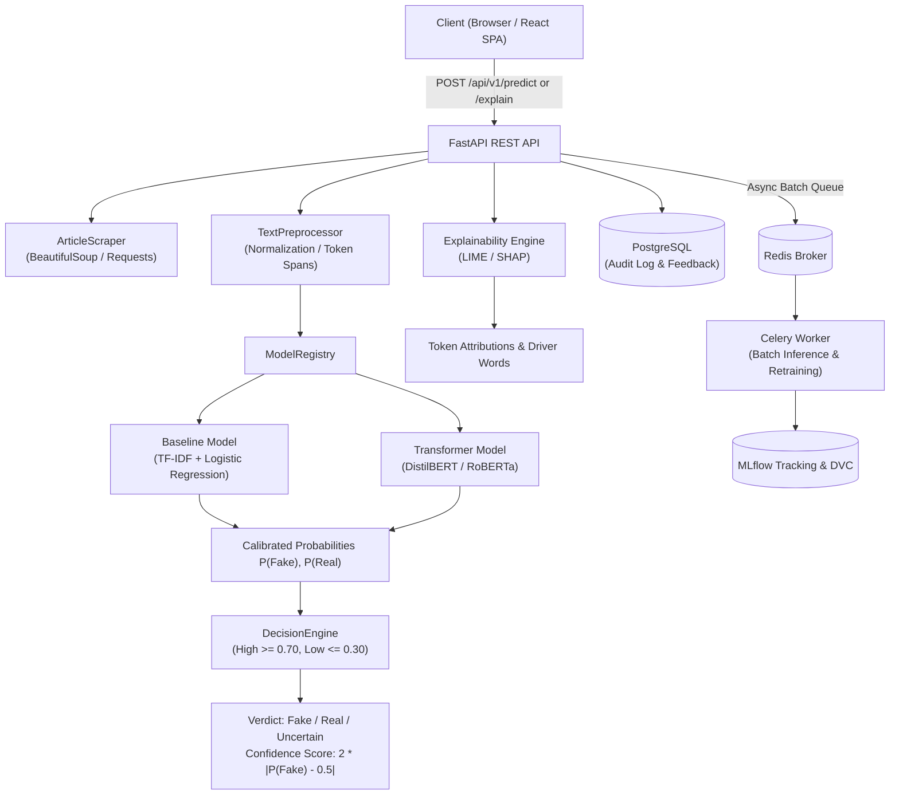

# AI-Based Fake News Detection System

[](https://github.com/organization/AI-Based-Fake-News-Detection/actions)
[](https://www.python.org/)
[](https://fastapi.tiangolo.com/)
[](https://react.dev/)
[](https://www.docker.com/)
[](https://github.com/astral-sh/ruff)

A production-grade, end-to-end Machine Learning system that analyzes news articles (via raw text or web URLs) and returns:
1. **Calibrated Verdict:** `Fake`, `Real`, or `Uncertain` (flagged for human review)
2. **Confidence Score:** Derived from calibrated probability boundaries $[0.0, 1.0]$
3. **Explainable AI (XAI) Attribution:** Token-level LIME and SHAP heatmaps highlighting words and sentences that drove the classification

---

## Architecture Overview



---

## Decision Logic & Calibration

Misinformation classification in mission-critical applications requires avoiding false certitude. The `DecisionEngine` uses calibrated probability bands:

* **$P(\text{Fake}) \ge 0.70$** $\longrightarrow$ **$\text{Fake}$** (High confidence misinformation)
* **$P(\text{Fake}) \le 0.30$** $\longrightarrow$ **$\text{Real}$** (High confidence authentic news)
* **$0.30 < P(\text{Fake}) < 0.70$** $\longrightarrow$ **$\text{Uncertain}$** (Ambiguous linguistic markers; automatically flagged with `requires_human_review = True`)

The **Confidence Score** is mathematically calibrated as:
$$\text{Confidence} = 2 \times |P(\text{Fake}) - 0.5|$$
* At $P(\text{Fake}) = 0.50$, Confidence $= 0.0$ (totally ambiguous)
* At $P(\text{Fake}) = 1.0$ or $0.0$, Confidence $= 1.0$ (maximum certainty)

---

## Tech Stack & Architecture Choices

| Domain | Technology | Justification |
| :--- | :--- | :--- |
| **Dependency Management** | [Astral `uv`](https://github.com/astral-sh/uv) | 10–100x faster than Poetry/pip, deterministic resolution, PEP 621 compliant |
| **Machine Learning** | Scikit-learn + PyTorch + Transformers | Calibrated TF-IDF Logistic Regression baseline + DistilBERT sequence classifier |
| **Explainability (XAI)** | LIME & SHAP | Local token attribution heatmaps and top driving n-grams |
| **Backend API** | FastAPI + Pydantic v2 | High-throughput asynchronous endpoints with OpenAPI contract generation |
| **Database & ORM** | PostgreSQL + SQLAlchemy 2.0 + Alembic | Transactional persistence of prediction records, articles, and human reviews |
| **Asynchronous Queue** | Celery + Redis | Background batch prediction jobs and long-running model retraining pipelines |
| **Frontend UI** | React 18 + TypeScript + Vite + Tailwind CSS | Interactive token heatmap visualizer, confidence gauges, and feedback modal |
| **Experiment Tracking** | MLflow | Hyperparameter, metric, and artifact tracking |
| **Data & Model Versioning** | DVC (Data Version Control) | Reproducible multistage data prep, training, and evaluation pipelines |
| **DevOps & CI/CD** | Docker Compose + GitHub Actions + Ruff | Multi-stage container builds, automated linter and full test execution |

---

## Quickstart: Local Development

### Prerequisites
* Python 3.11
* Node.js 20+ and npm
* Git

### 1. Clone & Configure Environment
```bash
git clone https://github.com/organization/AI-Based-Fake-News-Detection.git
cd AI-Based-Fake-News-Detection

# Create environment file from template
cp .env.example .env
```

### 2. Python Environment Setup with `uv`
```bash
# Create Python 3.11 virtual environment
uv venv .venv --python 3.11

# Activate virtual environment
# Windows:
.venv\Scripts\activate
# Linux/macOS:
source .venv/bin/activate

# Install all project dependencies in editable mode
uv pip install -e ".[dev]"
```

### 3. Database Migrations
```bash
alembic -c backend/alembic.ini upgrade head
```

### 4. Run Backend & Worker
```bash
# Terminal 1: FastAPI Server (http://localhost:8000)
uvicorn backend.app.main:app --reload --port 8000

# Terminal 2 (Optional): Celery Worker (requires local Redis running)
celery -A backend.app.workers.celery_app worker --loglevel=info
```

### 5. Run Frontend Development Server
```bash
cd frontend
npm install
npm run dev
# Frontend runs at http://localhost:5173 (proxies /api to localhost:8000)
```

---

## Production Deployment via Docker Compose

To launch the full microservices stack including PostgreSQL, Redis, MLflow, FastAPI backend, Celery worker, and Nginx frontend:

```bash
docker compose up --build -d
```

### Accessible Services:
* **Web Dashboard:** [http://localhost:3000](http://localhost:3000)
* **API Documentation (Swagger UI):** [http://localhost:8000/docs](http://localhost:8000/docs)
* **MLflow Tracking UI:** [http://localhost:5000](http://localhost:5000)
* **API Health Probe:** [http://localhost:8000/api/v1/health](http://localhost:8000/api/v1/health)

---

## REST API Reference

### 1. `POST /api/v1/predict`
Predict authenticity verdict for text or URL.

```bash
curl -X POST "http://localhost:8000/api/v1/predict" \
  -H "Content-Type: application/json" \
  -d '{
    "text": "The Federal Open Market Committee announced interest rate decisions today.",
    "title": "Fed Meeting Update",
    "model_type": "baseline"
  }'
```

**Response:**
```json
{
  "prediction_id": "4b68e925-1e35-4309-843e-b49bcfbc517c",
  "article_id": "8c41460c-26da-498c-be39-813f28d825c0",
  "title": "Fed Meeting Update",
  "verdict": "Real",
  "confidence_score": 0.72,
  "prob_fake": 0.14,
  "prob_real": 0.86,
  "requires_human_review": false,
  "model_type": "baseline",
  "threshold_applied": {
    "high": 0.7,
    "low": 0.3
  }
}
```

### 2. `POST /api/v1/explain`
Predict and compute token-level LIME or SHAP attributions.

```bash
curl -X POST "http://localhost:8000/api/v1/explain?method=lime" \
  -H "Content-Type: application/json" \
  -d '{
    "text": "Shocking miracle cure revealed by secret whistleblower overnight!"
  }'
```

**Response snippet:**
```json
{
  "prediction": {
    "verdict": "Fake",
    "confidence_score": 0.80,
    "prob_fake": 0.90,
    "prob_real": 0.10,
    "requires_human_review": false,
    "model_type": "baseline"
  },
  "explainer_method": "lime_text",
  "tokens": [
    { "text": "Shocking", "weight": 0.42, "impact": "fake", "intensity": 0.95 },
    { "text": "cure", "weight": 0.28, "impact": "fake", "intensity": 0.63 }
  ],
  "top_fake_drivers": [
    { "word": "shocking", "weight": 0.42 },
    { "word": "cure", "weight": 0.28 }
  ],
  "summary": "Prediction of Fake was primarily driven by sensational language such as 'shocking', 'cure'."
}
```

### 3. `POST /api/v1/feedback`
Submit human verification or correction on a prediction.

```bash
curl -X POST "http://localhost:8000/api/v1/feedback" \
  -H "Content-Type: application/json" \
  -d '{
    "prediction_id": "4b68e925-1e35-4309-843e-b49bcfbc517c",
    "user_verdict": "Real",
    "comments": "Verified against primary scientific journal."
  }'
```

---

## Machine Learning Pipeline & Versioning

### DVC Pipeline Reproduction
```bash
# Execute end-to-end data preparation, training, and evaluation
dvc repro
```

### MLflow Tracking
Training runs log parameters, validation metrics (Accuracy, Precision, Recall, F1, ROC-AUC), and serialized model weights directly to MLflow. Set `MLFLOW_TRACKING_URI` in `.env` to record experiments.

---

## Testing & Quality Assurance

Run the test suite and linters locally:

```bash
# Run Ruff linting and formatting checks
ruff check .
ruff format --check .

# Run complete Pytest suite (Unit & Integration tests)
pytest tests/ -v --cov=src/fake_news_detector --cov=backend/app

# Run Frontend Type-Check & Build
cd frontend
npm run build
```

---

## Security & Ethics Statement

* **No Authoritative Truth Claim:** Automated text analysis identifies lexical, stylistic, and syntactic correlations with known misinformation patterns. It does not replace investigative journalism or fact-checking consensus.
* **Secret Protection:** Secrets are never committed to version control. Production keys must be injected via runtime environment variables.
* **Human-in-the-Loop:** Predictions in the uncertain interval ($0.30 < P < 0.70$) explicitly recommend human review.

---

## License
MIT License.
